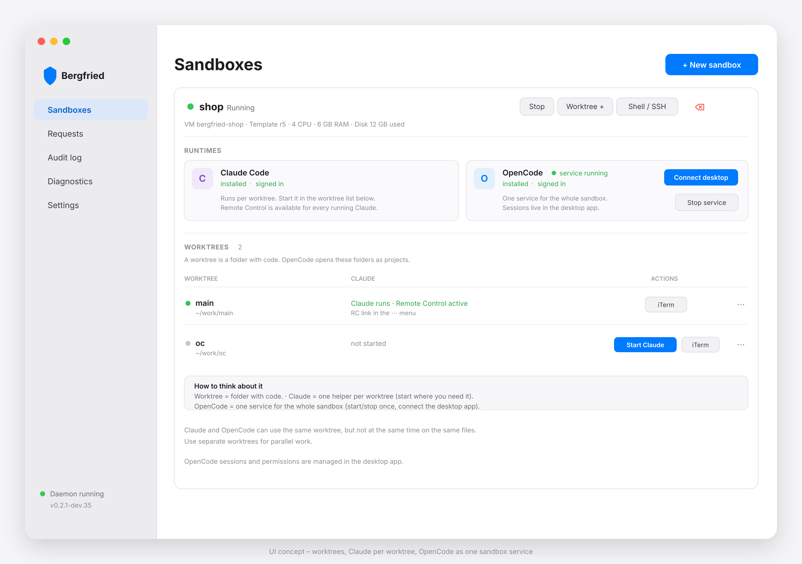
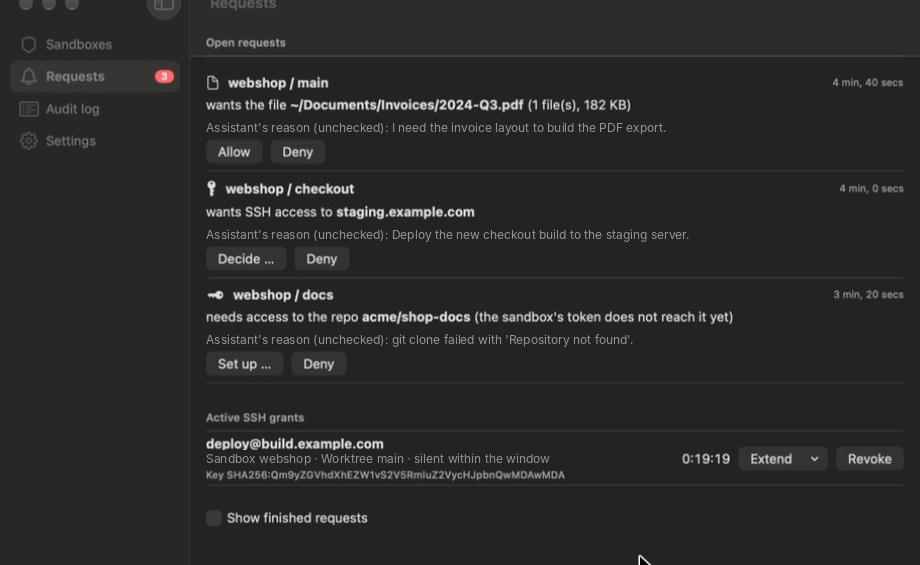
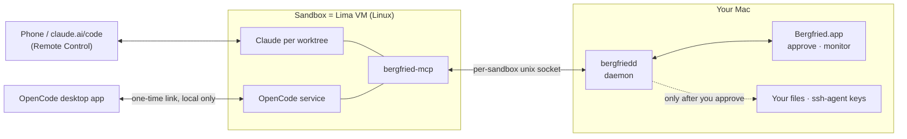

# Bergfried

**Run Claude Code and OpenCode in isolated VMs on your Mac — and decide, one request at a time, what they may touch.**



<sub>UI overview with made-up demo data ([tools/demoapi](tools/demoapi/demoapi.py)); the live app follows this layout.</sub>

Bergfried gives every project its own Linux VM (a **sandbox**) with Claude Code and the OpenCode service inside. Control Claude from your phone with Claude Code Remote Control and OpenCode from the OpenCode desktop app; the assistants
see nothing of your Mac until you say so: files, SSH access and GitHub access are **requests you approve in a native macOS app**.

## How it works in 30 seconds
1. **One sandbox = one project = one VM** (Lima, cloned from a base VM in seconds). Worktrees are folders with code; Claude runs per worktree in a tmux window, OpenCode runs once for the whole sandbox.
2. **The VM cannot see your Mac.** Only two folders are shared: `shared/in` (read-only, files you approved) and `shared/out`.
3. **The assistant asks, you decide.** It calls tools like `request_file` or `request_ssh`; the app shows a notification; every answer is logged. On a denial you can add a short note (e.g. "use the staging host instead") that the assistant sees.



4. **SSH keys never leave the Mac.** Bergfried signs *upstream with your real ssh-agent*, only during a grant you created (time window, key, target host key).
5. **Git uses a token you create per sandbox** (fine-grained, selected repos only), so plain `git push`/`pull` just works.
6. **Claude and OpenCode are separate.** Each worktree has its own Claude session (with Remote Control). OpenCode is one service for the whole sandbox, controlled from the desktop app; both can use the same worktree, but not at the same time on the same files.


More: [docs/ARCHITECTURE.md](docs/ARCHITECTURE.md).

## What the assistants can do

| | |
|---|---|
| Browse your files | Names, sizes and dates only; blocklisted places (`~/.ssh`, `~/Library`, `.env`, keys …) never appear |
| Get a file or folder | Only a read-only **copy**, after your approval |
| Use SSH | Only during a **grant** (duration, key, host key); the private key never leaves the Mac. Keys with a passphrase that are not loaded in your ssh-agent work too: you type the passphrase per grant, the key stays in memory until the grant ends |
| Use GitHub | Through the fine-grained token you made for that sandbox (git over HTTPS, Actions via API) |
| Anything inside its VM | Yes — install packages (`sudo apt-get install`), run Docker, start servers (reachable on `127.0.0.1` of the Mac). The image has `git`, `gh`, `git-lfs`, `make`, Docker, headless Chromium (screenshots, rendered pages), Claude Code and OpenCode |

Security model, trade-offs and known gaps: [docs/SECURITY.md](docs/SECURITY.md). Short version: the VM is the boundary; the GitHub token inside the VM is a deliberate trade-off.

## Get started
Requirements: Apple Silicon Mac, macOS 15+, [Lima](https://lima-vm.io) (`brew install lima`), Docker (only used to build the Go parts), Command Line Tools (`xcode-select --install`), and a Claude subscription and/or an OpenCode provider account.

```bash
git clone https://github.com/DevertNet/bergfried.git && cd bergfried
make build            # bin/bergfriedd, bin/bergfried-mcp
app/build.sh          # app/build/Bergfried.app
open app/build/Bergfried.app
```
In the app: **Settings → General → Install and start daemon**, **Settings → Base VM → Build now** (once, a few minutes), then **New sandbox**. The sandbox starts with the worktree `main`; start Claude in a worktree when you need it, and use OpenCode as a sandbox-wide service. Sign in once per runtime in the VM, then open Claude from your phone or OpenCode in the desktop app.
If something fails, the **Diagnostics** menu item shows the daemon log, the updater log and Lima's log per VM. Prefer the terminal? See [docs/testing/setup.md](docs/testing/setup.md). Released builds can update themselves from within the app ([docs/UPDATES.md](docs/UPDATES.md)).

### OpenCode desktop app
OpenCode is driven from the [OpenCode desktop app](https://opencode.ai/download), not from the phone. It is one service for the whole sandbox: Connect starts it and the desktop app opens the worktrees as projects, even if Claude was never started.
1. Start the sandbox and sign in to OpenCode (button in the OpenCode runtime card if needed).
2. In the **OpenCode** runtime card click **Connect** (or **Shell / SSH → Connect desktop app …**). Connecting installs OpenCode if it is missing.
3. Copy the one-time link (valid for 5 minutes) and paste it into the desktop app under **Add server**. Open the sandbox's worktrees as projects; Claude is not required.

The link uses a dedicated port per sandbox, works only on your Mac and is never exposed to the internet. A connection lasts 30 days; if a link expired, click Connect again. Claude keeps using Remote Control and is not listed in the desktop app. Use **Start service / Stop service** in the OpenCode card to control it; stopping it does not stop Claude.

### Or install a release
Download `Bergfried-<version>-macos-arm64.zip` from [Releases](https://github.com/DevertNet/bergfried/releases), unzip, move `Bergfried.app` to `/Applications` and open it.

**Known error on first launch.** The app is ad-hoc signed and **not notarized**, so macOS blocks a copy downloaded in a browser:

> *"Bergfried" not opened — Apple could not verify "Bergfried" is free of malware that may harm your Mac or compromise your privacy.*
> (German: *„Bergfried“ nicht geöffnet – Apple konnte nicht überprüfen, ob „Bergfried“ frei von Schadsoftware ist …*)

Click **Done** (not "Move to Bin"), then use one of these:
- **System Settings → Privacy & Security**, scroll down right after the failed attempt and click **Open Anyway** (German: *Datenschutz & Sicherheit → „Trotzdem öffnen“*), then confirm.
- Or remove the quarantine flag once in a terminal:
  ```bash
  xattr -dr com.apple.quarantine /Applications/Bergfried.app
  ```

Updates installed from inside the app are not quarantined. Only do this if you trust the repository: releases are unsigned ([docs/SECURITY.md](docs/SECURITY.md)).

## Status
Built by and for the author on macOS; **young software, not audited**. Releases come in two channels (stable and dev, see [docs/UPDATES.md](docs/UPDATES.md)); open work is in [docs/ROADMAP.md](docs/ROADMAP.md). The app is ad-hoc signed, so macOS asks for folder access again after each update. A Debian VPS host is designed but postponed.

## Documentation
[Architecture](docs/ARCHITECTURE.md) · [Security](docs/SECURITY.md) · [GitHub access](docs/GITHUB.md) · [Updates](docs/UPDATES.md) · [Development](docs/DEVELOPMENT.md) · [Roadmap](docs/ROADMAP.md) · [Manual tests](docs/testing/) · [UI overview](docs/design/runtime-separation-mockup.png) · [Settings overview](docs/design/settings-overview-mockup.png) · [Project rules](CLAUDE.md)

## License
Not chosen yet — until a license file is added, all rights are reserved.
