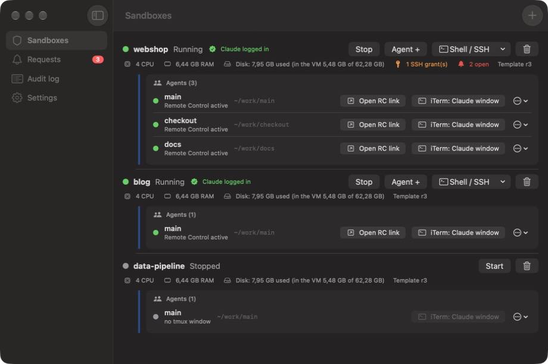
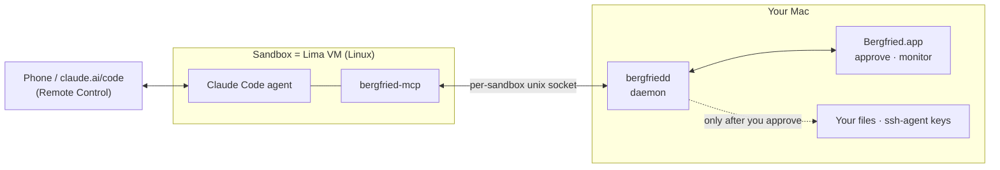

# Bergfried

**Run Claude Code agents in isolated VMs on your Mac — and decide, one request at a time, what they may touch.**



<sub>Screenshots show made-up demo data ([tools/demoapi](tools/demoapi/demoapi.py)).</sub>

Bergfried gives every project its own Linux VM (a **sandbox**) with a Claude Code agent inside. Control the agent from your phone with Claude Code Remote Control; the agent
sees nothing of your Mac until you say so: files, SSH access and GitHub access are **requests you approve in a native macOS app**.

## How it works in 30 seconds
1. **One sandbox = one project = one VM** (Lima, cloned from a base VM in seconds). Agents run in tmux windows with their own git worktrees.
2. **The VM cannot see your Mac.** Only two folders are shared: `shared/in` (read-only, files you approved) and `shared/out`.
3. **The agent asks, you decide.** It calls tools like `request_file` or `request_ssh`; the app shows a notification; every answer is logged.


4. **SSH keys never leave the Mac.** Bergfried signs *upstream with your real ssh-agent*, only during a grant you created (time window, key, target host key).
5. **Git uses a token you create per sandbox** (fine-grained, selected repos only), so plain `git push`/`pull` just works.


More: [docs/ARCHITECTURE.md](docs/ARCHITECTURE.md).

## What the agent can do

| | |
|---|---|
| Browse your files | Names, sizes and dates only; blocklisted places (`~/.ssh`, `~/Library`, `.env`, keys …) never appear |
| Get a file or folder | Only a read-only **copy**, after your approval |
| Use SSH | Only during a **grant** (duration, key, host key); the private key never leaves the Mac |
| Use GitHub | Through the fine-grained token you made for that sandbox (git over HTTPS, Actions via API) |
| Anything inside its VM | Yes — install packages, run Docker, start servers (reachable on `127.0.0.1` of the Mac) |

Security model, trade-offs and known gaps: [docs/SECURITY.md](docs/SECURITY.md). Short version: the VM is the boundary; the GitHub token inside the VM is a deliberate trade-off.

## Get started
Requirements: Apple Silicon Mac, macOS 15+, [Lima](https://lima-vm.io) (`brew install lima`), Docker (only used to build the Go parts), Command Line Tools (`xcode-select --install`), a claude.ai subscription.

```bash
git clone https://github.com/DevertNet/bergfried.git && cd bergfried
make build            # bin/bergfriedd, bin/bergfried-mcp
app/build.sh          # app/build/Bergfried.app
open app/build/Bergfried.app
```
In the app: **Settings → Install and start daemon**, **Settings → Base VM → Build now** (once, a few minutes), then **New sandbox**. Log in to Claude once per VM, and open the agent from your phone.
Prefer the terminal? See [docs/testing/setup.md](docs/testing/setup.md). Released builds can update themselves from within the app ([docs/UPDATES.md](docs/UPDATES.md)).

### Or install a release
Download `Bergfried-<version>-macos-arm64.zip` from [Releases](https://github.com/DevertNet/bergfried/releases), unzip, move `Bergfried.app` to `/Applications`. The app is **not notarized** (ad-hoc signed), so macOS blocks a browser-downloaded copy with "Apple could not verify …". Remove the quarantine flag once (or use System Settings → Privacy & Security → "Open Anyway" right after the first attempt; click **Done**, not "Move to Bin"):
```bash
xattr -dr com.apple.quarantine /Applications/Bergfried.app
```
Later updates installed from inside the app are not quarantined. Only do this if you trust the repository: releases are unsigned ([docs/SECURITY.md](docs/SECURITY.md)).

## Status
Built by and for the author on macOS; **young software, not audited**. Unverified areas are listed in [docs/ROADMAP.md](docs/ROADMAP.md) (next: real-GitHub run, first release). A Debian VPS host is designed but postponed.

## Documentation
[Architecture](docs/ARCHITECTURE.md) · [Security](docs/SECURITY.md) · [GitHub access](docs/GITHUB.md) · [Updates](docs/UPDATES.md) · [Development](docs/DEVELOPMENT.md) · [Roadmap](docs/ROADMAP.md) · [Manual tests](docs/testing/) · [Agent rules](CLAUDE.md)

## License
Not chosen yet — until a license file is added, all rights are reserved.
