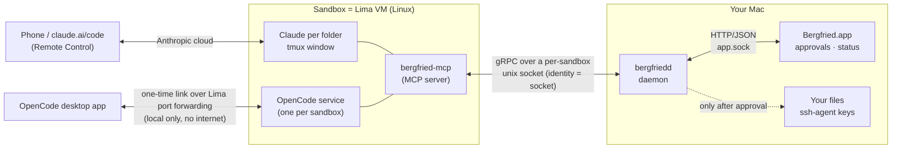
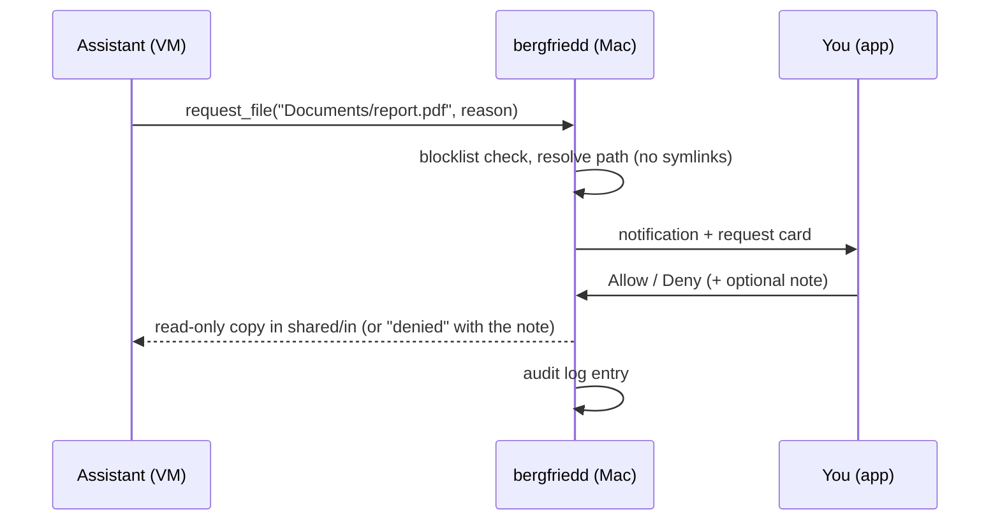

# Architecture

Bergfried runs Claude Code and OpenCode inside isolated Linux VMs (**sandboxes**) on your Mac. The assistants see nothing of your machine unless you approve it,
one request at a time. You control everything from a native macOS app. Claude is driven from the phone through Claude Code Remote Control, OpenCode from the OpenCode desktop app.



## Components

| Component | Where | What it does |
|---|---|---|
| `bergfriedd` | Mac (LaunchAgent, started by the app) | One Go binary: SQLite state, file-name index, per-sandbox sockets, SSH broker, monitor, HTTP/JSON API for the app. |
| `Bergfried.app` | Mac | SwiftUI control app (built with `swiftc`, no Xcode): sandboxes, Claude folders, requests, SSH grants, audit log, diagnostics (logs), settings, updates (stable/dev channel). |
| `bergfried-mcp` | inside each VM | MCP server for the assistants (`list_files`, `search_files`, `request_file`, `request_folder`, `request_ssh`, `release_ssh`, `request_github_token`) plus the `ssh-hook` subcommand. |
| Lima VM | `~/.lima/bergfried-<name>` | One VM per sandbox, cloned from a base VM named after the hash of the template (seconds instead of minutes). |
| `tools/fakegithub` | dev only | Fake GitHub (REST + git over HTTP) for tests. |

## How a request flows



SSH works the same way, but the daemon never hands out a key: it speaks the ssh-agent protocol to the VM and signs **upstream with your real ssh-agent**,
only while a grant is active (time window, key, target host key).

## Key design points

1. **One sandbox = one project = one Lima VM**, cloned from a base VM `bergfried-base-<hash of vm/bergfried.yaml>`. The base image contains `git`, `gh`, `git-lfs`, `make`, `jq`, `tmux`, Docker, headless `chromium`, Claude Code and OpenCode. The base VM is built on creation of the first sandbox with a new template hash or on "Build now"; existing sandboxes keep their image (the assistants are told to `sudo apt-get install` what is missing).
   The template is editable in the app and validated by `sandbox.CheckTemplate` (no mounts of your home, no `forwardAgent`, no Docker socket, both Bergfried sockets required). Your copy lives in `~/.bergfried/template/`:
   it is taken from the bundled template once, and at daemon start it is **replaced by a newer bundled template if you never edited it** (the copy equals the last adopted one, recorded in `seed.sha256`, or a known earlier bundled one; audit event `template.adopt`). An edited copy is kept and the app warns; "Reset template" adopts the bundled one.
2. **Exactly two mounts per sandbox:** `~/.bergfried/sandboxes/<name>/shared/in` (read-only) and `shared/out` (read-write). Existing folders are *copied* in (`importer`), never mounted.
3. **Identity of a sandbox = the socket.** For each running sandbox the daemon listens on `~/.lima/<vm>/sock/bergfried.sock` (gRPC `SandboxAPI`) and `ssh-agent.sock`.
   Lima forwards both into the VM (`/run/user/<uid>/bergfried.sock`, `bergfried-agent.sock`) with `reverse` port forwards. The *folder path* is only metadata claimed from inside the VM (same Linux user, not a security boundary), sent in the gRPC header `x-bergfried-folder`.
   Claude passes it via `BERGFRIED_FOLDER`; OpenCode's shared server starts one MCP process per project directory, so `bergfried-mcp` derives the folder from its working directory (`~/work/<folder>`) and only falls back to the environment variable.
4. **Files:** the index covers your home **minus the blocklist** (`~/.ssh`, `~/Library`, `~/.config`, `.env*`, keys, …). Requests for blocked paths are refused without asking. Approved files are copied to `shared/in/<sandbox>/…`.
   Building the index makes macOS ask for folder access (again after every update, because the app is ad-hoc signed), so the first build after an install or update waits behind `index.Gate`: the app explains it and the user confirms (`POST /v1/index/start`); the confirmed daemon version is stored in `~/.bergfried/index-ack`. A daemon not started from the app bundle is not gated.
5. **SSH:** the broker implements the ssh-agent protocol with destination constraints (`session-bind@openssh.com`). It signs only with an active grant **and** a matching target host key (fingerprint recorded at grant time from `known_hosts`/`ssh-keyscan`).
   A root-owned `Match exec` hook in the VM turns a plain `ssh host` into a request; interactive `ssh` waits for your decision.
   Keys that are not in the ssh-agent (passphrase-protected key files in `~/.ssh`) are offered too: the passphrase typed for the grant decrypts the key into the daemon's memory for the length of the grant (`broker/localkeys.go`; see [SECURITY.md](SECURITY.md)).
   `RequestSSH` returns the grant id as `task_id`; one grant belongs to one task. When the task is finished the assistant calls `ReleaseSSH` (`release_ssh`) with that `task_id` and the daemon revokes exactly that grant of the calling sandbox (rewrite the VM config, terminate running `ssh`).
6. **GitHub:** one fine-grained token per sandbox, stored in the VM (`~/.git-credentials`, also used to log in `gh`) and used by plain `git` over HTTPS. See [GITHUB.md](GITHUB.md).
7. **Claude works in folders:** a Claude entry is a folder under `~/work` (`main` = `~/work/main`) plus a Claude session. Creating a sandbox creates `main` with Claude stopped; adding a Claude entry only selects an existing folder. Bergfried does **not** create git worktrees or branches.
   The database stores per entry whether Claude should run. Claude is started explicitly, then runs `cd ~/work/<folder> && claude --continue --remote-control '<sandbox>/<window>'` in a tmux window (tmux session `bf`); `COMPOSE_PROJECT_NAME=<sandbox>-<window>` separates Docker stacks.
   The **monitor** polls running VMs (login and installed state, Remote Control status and link per Claude entry, OpenCode installed/running, disk usage), restarts Claude entries after a Claude login,
   answers Claude onboarding prompts with Enter and activates Remote Control (confirmation `y`, restart or `/remote-control`, max. 3 attempts).
8. **OpenCode is a sandbox-level service:** one service and one desktop link per sandbox, not one per Claude folder. It can run without Claude; the desktop app opens the folders as projects.
   It is connected through a one-time local link (`opencode pair`, no internet): the OpenCode server listens on a stable per-sandbox port on `0.0.0.0` and Lima forwards it to `127.0.0.1` on the Mac.
   Before a link is created the daemon restarts the service so it really uses that port (the config may already be right while the running process is stale).
   OpenCode is installed on demand in older VMs with the official installer (latest version, user-local, no root/apt); leftovers of earlier attempts are removed first and the install log is in `/tmp/opencode-install.log`. **Start service / Stop service** in the app control the service; connecting installs it on demand if missing. The wanted state is stored per sandbox (`sandboxes.opencode`) and restored after a sandbox start.
   A tmux window that still runs an old OpenCode TUI or a manual start is killed when the sandbox starts and by the monitor if its entry has Claude stopped – this is how the migration terminates existing OpenCode TUI windows.
9. **UI:** the sandbox overview is one alphabetical card list. Each card has the state/actions, a compact metadata line, a Claude card (installed, signed in, **+ Claude**, the folder list with start/stop actions and a folder browser that can create folders) and an OpenCode card (installed, signed in, service running, Start/Stop service, Connect desktop). There is no separate worktree table or runtime column; the RC link stays in the row's ellipsis menu. Settings has a secondary sidebar: General, Updates, Base VM, Notifications, Files & index, Terminal, Advanced (template editor behind Advanced). Base-build output follows new lines while the view is at the bottom.
10. **App ↔ daemon** speak HTTP/JSON over `~/.bergfried/app.sock` (0600). gRPC is used VM ↔ daemon and CLI ↔ daemon. The app is the decision maker; the daemon runs with `--no-dialog`.

## Data on your Mac

`~/.bergfried` (0700): `bergfried.db`, `blocklist.json`, `hosts.json`, `settings.json` (update channel), `template/` (`bergfried.yaml`, `revision`, `seed.sha256`), `index-ack`, `update/` (staged releases, backups, `update.log`), `sandboxes/<name>/{shared/{in,out},github-token}`, `admin.sock`, `app.sock`, `daemon.log` (see [DEVELOPMENT.md](DEVELOPMENT.md#logs)).
Naming: VMs are `bergfried-<sandbox>` (≤ 24 characters, `base` reserved), base VMs `bergfried-base-<hash>`.

## Code layout

```
daemon/cmd/bergfriedd        CLI + serve
daemon/internal/             access, api (+monitor), broker, ghtoken, github, importer, index, lima, notify, rpc, sandbox, store, update
mcp/cmd/bergfried-mcp        MCP server + ssh-hook (runs in the VM)
proto/                       protobuf definitions; generated code in proto/gen (checked in)
app/                         SwiftUI app sources, build.sh, icon
vm/bergfried.yaml            default Lima template
tools/fakegithub             test double for GitHub
```
