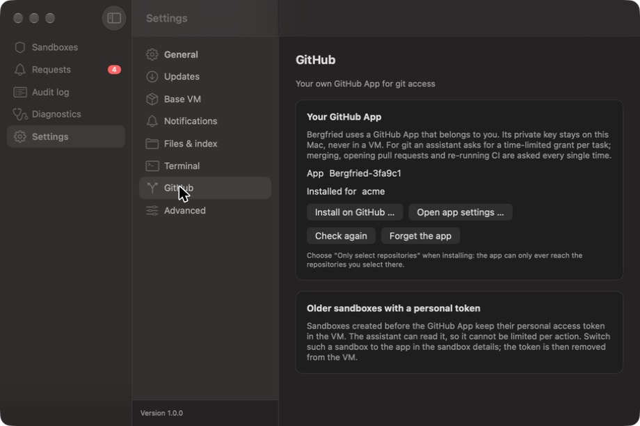

# Git and GitHub: your own GitHub App

Every Bergfried user sets up **their own GitHub App**. Its private key stays on the Mac (`~/.bergfried/github-app/`, 0600) and never enters a VM. There is **no standing token in the VM**: what an assistant may do on GitHub is decided by requests you approve.

| What the assistant does | How | Your approval |
|---|---|---|
| `git clone/fetch/pull/push` | **Git grant** (like an SSH grant): `request_git_access` → credential helper in the VM → short-lived token → `release_git_access` | once per task, with duration (5–60 min) and level (read / read+write) |
| open a PR, merge a PR, re-run failed CI jobs | MCP tools `github_create_pr`, `github_merge_pr`, `github_rerun_ci`, executed **by the daemon** | **every single time** (the card shows the PR title and branches as GitHub reports them) |
| read a PR / CI runs | `github_pr_view`, `github_ci_status` | none, but an active grant for the repo is required |

Not possible for assistants: creating repositories, changing `.github/workflows` (the app has neither the Administration nor the Workflows permission).

## Setting up the app (Settings → GitHub)
1. "Set up GitHub App …": the daemon starts a short-lived web server on `127.0.0.1:<random port>` and opens it in the browser. It forwards you to GitHub with a **manifest** (name `Bergfried-<random>`, permissions *Contents*, *Pull requests*, *Actions* = write, *Metadata* = read, no webhook, not public). You confirm "Create GitHub App" on GitHub.
2. GitHub redirects back to the local server with a one-time `code` (the `state` is checked). The daemon exchanges it (`POST /app-manifests/{code}/conversions`) for app id and private key and stores them (`app.json`, `private-key.pem`, both 0600).
3. The local page links to the installation: choose **Only select repositories** and pick the repos your assistants may use. The app can only ever reach what you select there. Repos can be added later on GitHub; a repo the app cannot reach is refused before any card appears.
4. "Forget the app" deletes the key on the Mac and ends all grants. The app itself stays on GitHub (delete it there).

## Git grants

- The assistant calls `request_git_access(repo, write, minutes, reason)`. The card shows repo, level, the assistant's (unchecked) reason and the other active grants of the sandbox. You choose duration and level; you can lower the level but never raise it above the request. Maximum 60 minutes (GitHub installation tokens live one hour).
- The VM has a git credential helper for `https://github.com` (`credential.https://github.com.helper = !/usr/local/bin/bergfried-mcp git-credential`, `useHttpPath` so the helper sees `owner/repo`). On `git`'s request the helper asks the daemon over the sandbox socket. **Without an active grant it prints nothing to stdout** (git then fails with its usual "could not read Username") and a hint to stderr (`call request_git_access`). It never stores anything (`store`/`erase` are no-ops).
- With a grant the daemon mints an **installation token** narrowed to the granted repos (`repositories`) and to `contents: read` or `contents: write` (nothing else: no merge through the VM token, no Actions). Tokens are kept in the database (0600) only so they can be revoked.
- **Several grants in one sandbox share one token** (the union of the repos of that owner; write if any grant is write). When the set changes, a new token is minted and the replaced one is revoked after a **2-minute grace time**, so a running push of another grant is not cut off.
- `release_git_access(task_id)` ends the grant and revokes the token on GitHub right away (immediately when no other grant of that owner remains). It needs no approval (it only reduces access) and only works for grants of the calling sandbox; an unknown id and a foreign id give the same answer. Expiry, "Revoke" in the app, stopping or deleting the sandbox, and "Forget the app" end grants and revoke tokens the same way. A daemon restart does not lose track: tokens and grants are in the database and the sweep (every 5 s) revokes what is due.
- Releasing is a **rule for the assistant, not a barrier**: if it forgets, the timer ends the grant. A token the assistant copied is dead as soon as it is revoked on GitHub.

The Requests tab lists **active git grants** (repo, level, countdown, Revoke) and keeps **the assistant's reason** with every active grant and every finished request ([screenshot](img/requests-grants.png)).

## API actions (merge, pull request, CI)
`Service.Action` executes one action per request with a token minted for that call only: one repository, the minimal permissions (`pull_requests`, `contents`, `actions`), revoked right after use. For a merge the daemon first reads the PR from GitHub, so the card shows title, head → base and merge method from GitHub, not the assistant's text. Closed PRs are refused without asking.

## Older sandboxes with a personal access token (legacy)
Sandboxes created before the app keep working: their token stays in `~/.git-credentials` (0600) and `gh` stays logged in, and `request_github_token` still exists (fine-grained PAT, see git history of this file for the old flow). The credential-helper setup does **not** enable `useHttpPath` in a VM that has `~/.git-credentials` (it would hide the stored entry from the `store` helper; tested with git 2.54).
The sandbox details show a **Switch to GitHub App** button: it removes `~/.git-credentials`, the `gh` login and the Mac copy (`ghtoken.removed` in the audit log) and enables the helper. The old token is not revoked for you: delete it on GitHub.

## Audit
`git.requested`, `git.allowed`, `git.denied`, `git.request_expired`, `git.token` (owner, repos, level, expiry – never the token), `git.token_revoked`, `git.released`, `git.revoked`, `git.expired`, `git.action.requested|allowed|denied|done|failed`, `githubapp.setup.start|done|failed`, `githubapp.forget`. Tokens never appear in audit entries, API responses or logs (test `TestTokensNeverReachTheAuditLog`).

## Verified and open
- Verified here: JWT (RS256, `iat` −60 s, `exp` +9 min), token narrowing, revoke, union/grace/expiry/isolation logic, the manifest flow against a local stand-in, the credential helper protocol with real git 2.54 (path with `useHttpPath`, hint on stderr, failure without grant). All **against stand-ins, not against real GitHub**.
- **Not yet verified against real GitHub** (do this with a test repo, see [testing/github.md](testing/github.md)): whether GitHub accepts `redirect_url` on `127.0.0.1` and a manifest without `hook_attributes`; the response field names of the conversion (`id`, `slug`, `client_id`, `pem`); whether `contents:write` + `pull_requests:write` suffice to merge and whether `pull_requests:write` + `contents:read` suffice to open a PR; push with `x-access-token`; the new token format (`ghs_…` may be longer than 40 characters); rate limits when minting often.
- Within a write grant the assistant can push to **any branch including `main` and force-push** unless GitHub protects the branch (branch protection / rulesets; not available for private repos on the Free plan).
- The boundary is the **sandbox**: all assistants of a VM share the Linux user, so a grant requested by one assistant can be used by another one in the same VM (the folder in the card is a hint).
- Open: several GitHub accounts at once, GitHub Enterprise and other hosts, a per-push approval with the real diff (git remote helper), removing the legacy `request_github_token` once all sandboxes are migrated.
