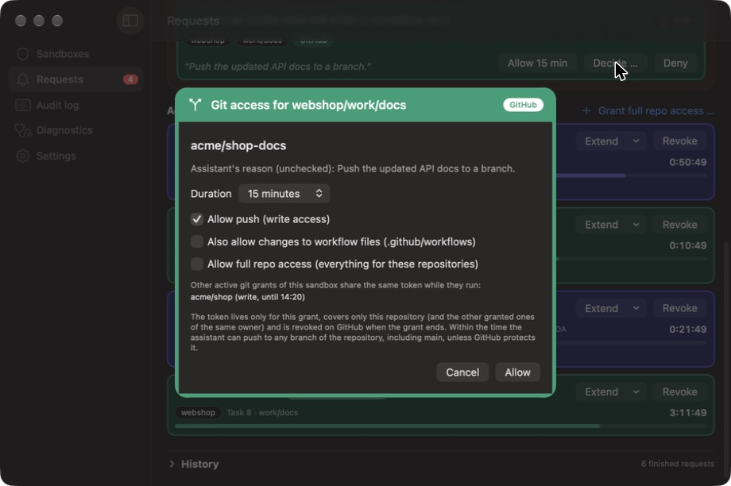
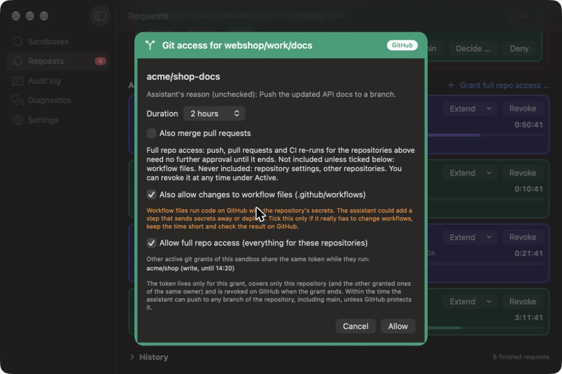

# Git and GitHub: your own GitHub App

Every Bergfried user sets up **their own GitHub App**. Its private key stays on the Mac (`~/.bergfried/github-app/`, 0600) and never enters a VM. There is **no standing token in the VM**: what an assistant may do on GitHub is decided by requests you approve.

| What the assistant does | How | Your approval |
|---|---|---|
| `git clone/fetch/pull/push` | **Git grant** (like an SSH grant): `request_git_access` → credential helper in the VM → short-lived token → `release_git_access` | once per task, with duration (5–60 min) and level (read / read+write) |
| open a PR, merge a PR, re-run failed CI jobs | MCP tools `github_create_pr`, `github_merge_pr`, `github_rerun_ci`, executed **by the daemon** | **every single time** (the card shows the PR title and branches as GitHub reports them) |
| read a PR / CI runs | `github_pr_view`, `github_ci_status` | none, but an active grant for the repo is required |

Not possible for assistants: creating repositories (the app has no Administration permission). Changing `.github/workflows` is possible **only if you tick "workflow files"** in the git grant or full repo access ([below](#workflow-files)); otherwise GitHub rejects the push.

## Setting up the app (Settings → GitHub)
1. "Set up GitHub App …": the daemon starts a short-lived web server on `127.0.0.1:<random port>` and opens it in the browser. It forwards you to GitHub with a **manifest** (name `Bergfried-<random>`, permissions *Contents*, *Pull requests*, *Actions* = write, *Metadata* = read, no webhook, not public). You confirm "Create GitHub App" on GitHub.
2. GitHub redirects back to the local server with a one-time `code` (the `state` is checked). The daemon exchanges it (`POST /app-manifests/{code}/conversions`) for app id and private key and stores them (`app.json`, `private-key.pem`, both 0600).
3. The local page links to the installation: choose **Only select repositories** and pick the repos your assistants may use. The app can only ever reach what you select there. Repos can be added later on GitHub; a repo the app cannot reach is refused before any card appears.
4. "Forget the app" deletes the key on the Mac and ends all grants. The app itself stays on GitHub (delete it there).

## Git grants

- The assistant calls `request_git_access(repo, write, minutes, reason)` (plus `workflows` for workflow files, see below). For a task with several repos (clone or push four at once) it passes the others in `repos` (max 10 in total): **one card, one decision** (duration and level apply to all), one grant per repo with its own `task_id`; the result lists them as `task_ids`. If the app is not installed on one of the repos nothing is asked and the answer names that repo. The card shows repo(s), level, the assistant's (unchecked) reason and the other active grants of the sandbox. You choose duration and level; you can lower the level but never raise it above the request. Maximum 60 minutes (GitHub installation tokens live one hour).
- The VM has a git credential helper for `https://github.com` (`credential.https://github.com.helper = !/usr/local/bin/bergfried-mcp git-credential`, `useHttpPath` so the helper sees `owner/repo`). On `git`'s request the helper asks the daemon over the sandbox socket. **Without an active grant it prints nothing to stdout** (git then fails with its usual "could not read Username") and a hint to stderr (`call request_git_access`). It never stores anything (`store`/`erase` are no-ops).
- With a grant the daemon mints an **installation token** narrowed to the granted repos (`repositories`) and to `contents: read` or `contents: write` (nothing else: no merge through the VM token, no Actions). Tokens are kept in the database (0600) only so they can be revoked.
- **Several grants in one sandbox share one token** (the union of the repos of that owner; write if any grant is write). When the set changes, a new token is minted and the replaced one is revoked after a **2-minute grace time**, so a running push of another grant is not cut off.
- `release_git_access(task_id)` (or `task_ids` for a multi-repo request) ends the grant and revokes the token on GitHub right away (immediately when no other grant of that owner remains). It needs no approval (it only reduces access) and only works for grants of the calling sandbox; an unknown id and a foreign id give the same answer. Expiry, "Revoke" in the app, stopping or deleting the sandbox, and "Forget the app" end grants and revoke tokens the same way. A daemon restart does not lose track: tokens and grants are in the database and the sweep (every 5 s) revokes what is due.
- Releasing is a **rule for the assistant, not a barrier**: if it forgets, the timer ends the grant. A token the assistant copied is dead as soon as it is revoked on GitHub.

## Full repo access
For a day of many changes in one repo, approving every grant and every PR or CI call is tedious. **Full repo access** is your own offer for one repository of one sandbox for a fixed time (1, 2, 3, 4, 8 or 24 hours). Internally it is a git grant with a flag (`is_window`, `can_merge`); audit events and code still say "window".

- **Included:** git read and write (the normal git grant; the token is re-minted automatically while the access runs, so it may last longer than 60 minutes), `github_pr_create` and `github_ci_rerun` without a card. **Merging** (`github_pr_merge`) only if you tick *Also merge pull requests*; otherwise it still asks every time.
- **Not included:** other repositories, other sandboxes, SSH, repository settings and administration (the app has no such permission). **Workflow files** (`.github/workflows`) only if you tick *Also allow changes to workflow files*, see [Workflow files](#workflow-files).
- **Several per sandbox** (one per repository); granting it again for a repo that already has it replaces the old one (new duration and merge setting).
- **How to grant it:** in the decision sheet of a git request tick *Allow full repo access* (applies to all repos of that request), or in the Requests page choose *Grant full repo access …* (sandbox, `owner/name`, duration, merge) without waiting for a request. While it runs, `request_git_access` for that repo is answered at once without a card.

- **The assistant cannot end it:** `release_git_access` on it changes nothing and says so. You end it with *Revoke* (same as a git grant; the token is revoked on GitHub); it also ends at the deadline, when the sandbox stops or is deleted, or on "Forget the app".
- **Audit:** `git.window.opened`, `git.window.used` (a grant request answered by full repo access) and `git.action.auto` (an action done under it, with its id).

Under full repo access the assistant can push to any branch including `main` (see below). There is no warning before it ends; the countdown in the Requests page turns red in the last two minutes. *Extend* works for full repo access (up to 24 hours from now) and for normal git grants (up to 60 minutes from now); audit `git.extended`.

## Workflow files
Pushing to `.github/workflows` needs the GitHub permission **Workflows** (GitHub rejects the push otherwise). The app holds this permission (it is in the manifest of new apps), but **a token only gets it for a repository whose grant you ticked** *Also allow changes to workflow files* (in the git grant sheet for write access, in the full repo access sheet and in *Grant full repo access …*). Details:

- **Per repository:** repos with the tick get their own token (`contents: write` + `workflows: write`, only those repos); all other repos of the same owner keep a token without `workflows`. The audit entry `git.token` says `workflows=write` when such a token was minted. The tick counts only together with write access; if you lower a grant to read-only it is dropped. **The assistant can ask for it** (`request_git_access(…, write=true, workflows=true)`, only when the task really needs it): the card then says "incl. workflow files" and warns in orange, there is **no one-click allow**, and *Decide …* opens the sheet with the box already ticked, so you only press *Allow* (or untick it). Under full repo access a request with `workflows=true` is answered at once only if that access already has the tick, otherwise you are asked.
- **The risk is yours:** a workflow runs code on GitHub's runners with the repository's secrets and, depending on the settings, a more powerful token than Bergfried's. While the grant runs the assistant can change **any** workflow file of that repo (not only a reviewed one), whether by mistake or because of text it read in an issue, a web page or a file, e.g. a step that sends secrets away or deploys. The sheet therefore warns in orange. Keep the time short, tick it only when needed, and look at the workflow changes on GitHub (a diff-reviewed alternative, a Bergfried tool that shows the diff on a card first, is not built, see [ROADMAP](ROADMAP.md)).
- **Existing apps need the permission in two steps:** (1) *Settings → GitHub → Open app settings …*, add **Workflows: Read and write** under repository permissions and save; (2) the owner of **each installation accepts** the new permission once (GitHub shows a "review request" on the installation page; Settings has a *Review permissions …* button that opens `github.com/settings/installations/<id>`, or `github.com/organizations/<org>/settings/installations/<id>` for an organisation). Until step 2 the installation does not have the permission even though the app does. Settings shows an orange note per installation that still lacks it and says which step is missing (it reads the app's permissions from `GET /app` and the installation's from `GET /app/installations`). Without it a grant with workflow files fails with a message naming the missing permission; repos without the tick are not affected.
- **Not verified against real GitHub** (like the rest of the app flow): the manifest key `workflows`, the minting with that permission and the acceptance step are built from GitHub's documentation and tested against stand-ins only.

The Requests page shows open requests on top and **active git grants and full repo access** below (repo, level, remaining-time bar and countdown, Extend, Revoke), together with SSH grants, and keeps **the assistant's reason** with every active grant and every finished request. *Allow N min* on a git request is a one-click allow of exactly what was asked (at most 15 minutes). ([screenshot](img/requests-grants.png))

## API actions (merge, pull request, CI)
`Service.Action` executes one action per request with a token minted for that call only: one repository, the minimal permissions (`pull_requests`, `contents`, `actions`), revoked right after use. For a merge the daemon first reads the PR from GitHub, so the card shows title, head → base and merge method from GitHub, not the assistant's text. Closed PRs are refused without asking.

## Older sandboxes with a personal access token (legacy)
Sandboxes created before the app keep working: their token stays in `~/.git-credentials` (0600) and `gh` stays logged in, and `request_github_token` still exists (fine-grained PAT, see git history of this file for the old flow). The credential-helper setup does **not** enable `useHttpPath` in a VM that has `~/.git-credentials` (it would hide the stored entry from the `store` helper; tested with git 2.54).
The sandbox details show a **Switch to GitHub App** button: it removes `~/.git-credentials`, the `gh` login and the Mac copy (`ghtoken.removed` in the audit log) and enables the helper. The old token is not revoked for you: delete it on GitHub.

## Audit
`git.requested`, `git.allowed`, `git.denied`, `git.request_expired`, `git.token` (owner, repos, level, expiry – never the token), `git.token_revoked`, `git.released`, `git.revoked`, `git.expired`, `git.action.requested|allowed|denied|done|failed`, `githubapp.setup.start|done|failed`, `githubapp.forget`. Tokens never appear in audit entries, API responses or logs (test `TestTokensNeverReachTheAuditLog`).

## Verified and open
- Verified here: JWT (RS256, `iat` −60 s, `exp` +9 min), token narrowing, revoke, union/grace/expiry/isolation logic, the manifest flow against a local stand-in, the credential helper protocol with real git 2.54 (path with `useHttpPath`, hint on stderr, failure without grant). All **against stand-ins, not against real GitHub**.
- **Not yet verified against real GitHub** (do this with a test repo, see [testing/github.md](testing/github.md)): whether GitHub accepts `redirect_url` on `127.0.0.1` and a manifest without `hook_attributes`; the response field names of the conversion (`id`, `slug`, `client_id`, `pem`); whether `contents:write` + `pull_requests:write` suffice to merge and whether `pull_requests:write` + `contents:read` suffice to open a PR; push with `x-access-token`; the new token format (`ghs_…` may be longer than 40 characters); rate limits when minting often.
- Within a write grant the assistant can push to **any branch including `main` and force-push** unless GitHub protects the branch (branch protection / rulesets; not available for private repos on the Free plan).
- The boundary is the **sandbox**: all assistants of a VM share the Linux user, so a grant requested by one assistant can be used by another one in the same VM (the folder in the card is a hint).
- Open: several GitHub accounts at once, GitHub Enterprise and other hosts, a per-push approval with the real diff (git remote helper), removing the legacy `request_github_token` once all sandboxes are migrated.
