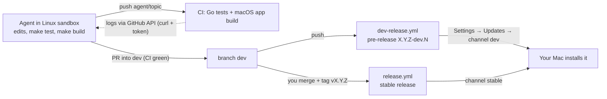

# Plan: develop Bergfried inside a sandbox (agreed scope, not started)

**Goal:** an agent in a Linux sandbox does most of the development of Bergfried (Go, tests, docs, Swift source edits). The macOS-only parts (building and trying the app) are covered by CI and by releases on two channels. The 25.6 GB macOS VM is postponed ([macos-sandboxes.md](macos-sandboxes.md)); the channel design is in [release-channels.md](release-channels.md).

## How the loop works

## What already works in a Linux sandbox
`make test`, `make vet`, `make fmt`, `make build` (cross-compiles the darwin daemon with Docker), `make proto`, `tools/fakegithub`, `tools/demoapi` (Python), editing Swift/Markdown, git and the GitHub API with the sandbox token, reading CI logs.

## Steps
**A. Repository and GitHub (you, before any agent gets the repo)**
1. Make the repository public.
2. Rulesets (free for public repos): `main` — pull request + your approval, no bypass for the token's account; tags `v*` — creation restricted, no bypass for the token's account; `dev` — pull request with green CI required, agents may merge; feature branches `agent/*` open.
3. Sandbox token for this repo: only this repository, Contents RW, Pull requests RW, Actions RW (read logs, re-run), no Workflows permission.

**B. CI and releases (agent can do, you review the workflow files — the token cannot change them)**
4. `ci.yml`: every branch + PRs; add a **strings check** (every `L("…")` key present in `de.lproj`) and `swiftc -parse` style checks where possible.
5. `dev-release.yml`: push to `dev` → tests, app build, pre-release `vX.Y.Z-dev.N`, prune to the newest 10; `concurrency` group so a newer push cancels older builds.
6. `release.yml` stays tag-only (`vX.Y.Z`).

**C. Updater and app**
7. Channel setting (`stable`/`dev`), release list instead of `/latest`, pre-release ordering, tests; picker in Settings → Updates (EN/DE) with a warning for dev.
8. **Rollback:** a documented procedure and a daemon command `bergfriedd update rollback` (restores `Bergfried.app.previous` and the database backup from `~/.bergfried/update/`), because a broken dev build can take down the control plane.

**D. Helpers for the agent**
9. `scripts/ci-status.sh` — latest run for a branch, failing job and the end of its log through the GitHub API (no `gh` in sandboxes).
10. `CLAUDE.md` section "Working inside a sandbox": what to run (tests only), never start the real daemon or Lima, use a temporary `BERGFRIED_HOME`, branch `agent/<topic>` → PR into `dev`, how to read CI, what cannot be verified (UI, VMs, macOS-only code).
11. Optional: install the Swift toolchain in the sandbox for `swiftc -parse` (syntax only; SwiftUI cannot be type-checked on Linux — **untested**).

**E. First run**
12. Create a test sandbox with this repo, let the agent make a small change through the whole loop (branch → CI → PR → `dev` → pre-release → install on your Mac via the dev channel → roll back), and write down what failed.

## Problems to expect
**Verification gaps (cannot be closed inside a sandbox)**
- **The app can only be compiled by CI** (2–3 minutes per try); no UI inspection by the agent; layout and permission prompts are checked by you.
- **No end-to-end tests with real VMs** (Lima cannot start VMs inside a VM). macOS-specific code (`osascript`, `launchctl`, Keychain, BSD `ps`/`df`, the updater swap) runs only against fakes there.
- **No signing or notarisation**; builds stay ad-hoc signed (the Gatekeeper warning for browser downloads remains).

**Risks of installing dev builds on the Mac that runs your sandboxes**
- A broken daemon or app update can take down approvals for all running agents; database migrations are forward-only (rollback needs the backup). → step 8, and keep a stable install you trust.
- Updating restarts daemon and app: requests waiting at that moment are dropped; the old `bergfried-mcp` inside running VMs may not match a new daemon until the sandbox restarts (gRPC compatibility must be kept or the sandbox restarted).
- If a **second** Bergfried instance (a dev build next to the stable one) is ever run against the same Lima home, it would clean up "old" base VMs and mix up names. Do not do that without a name prefix per instance (not built; open design question: side-by-side "Bergfried Dev" with its own bundle id, data directory and VM prefix).

**Security**
- The agent's token can push to `dev` and so publish a dev pre-release; installing still needs your confirmation. A stable tag or a push to `main` must be blocked by the rulesets in step 2 — without them the agent could ship code to your Mac. Releases are unsigned.
- The token lives in the VM and is readable by the agent (documented trade-off, [../GITHUB.md](../GITHUB.md)); a public repo lowers what a leak exposes.

**Process and cost**
- Every push to `dev` builds on a macOS runner (free for public repos **if** that applies to macOS minutes — unverified; private repos bill macOS minutes at a higher rate).
- Unauthenticated GitHub API calls are limited to 60 per hour per IP; the updater checks every 6 hours, which is fine.
- Dev builds are numbered by CI run number, so they are strictly increasing; after a stable release the dev base version moves to the next patch. There is no automatic downgrade from dev to stable.
- GitHub limits for releases: ≤ 1000 assets per release, each < 2 GiB, no total-size or bandwidth limit, no stated limit on the number of releases.
- The agent is not a replacement for review: keep pull requests small, and read changes in `daemon/internal/{broker,access,index,importer,update}` yourself (security-relevant).

## Order of work
A (you) → B + D in parallel → C → E. Nothing in C or E starts before the rulesets in A exist.
