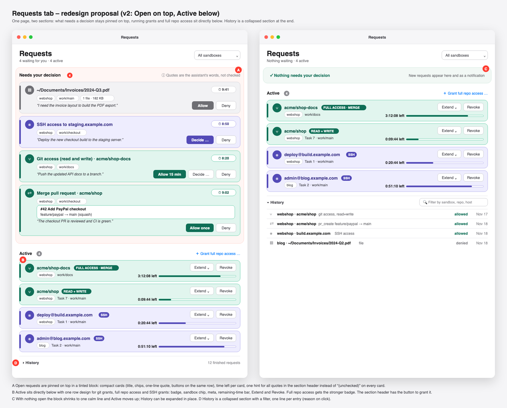

# Requests tab redesign (proposal)

Source: [requests-redesign-mockup.svg](requests-redesign-mockup.svg). Status: **implemented** (Requests page with Open on top, Active below, collapsed History; time left from `expires_unix`, Extend for git grants and windows). The screenshots in `docs/img/` show the implementation.

## Problems today
- One long list: open requests, active git grants, active SSH grants and the history toggle are stacked, so the grants and history sit below the fold as soon as four requests are open.
- Every row repeats the label "Assistant's reason (unchecked)" and starts with a bold `sandbox / folder` path; the actual question ("wants …") is hard to find.
- Open requests do not show how long they can still be answered (they expire after 10 minutes).
- Git grants, full repo access and SSH grants look different from each other; full repo access is not recognisable.
- Several similar requests cannot be handled together.

## Proposal (v2: one page, Open on top, Active below)
1. **One page, three blocks:** a tinted block **Needs your decision** is pinned on top, **Active** (grants and full repo access) sits directly below, **History** is a collapsed section at the end. No tabs: you see what is running while you decide. The Dock and sidebar badges stay. A sandbox filter sits top right.
2. **Compact card per kind (A):** colour stripe, icon, kind colour as today (SSH violet, GitHub green, files neutral). Title = what is asked ("SSH access to staging.example.com"). Sandbox and folder are chips below the title, the reason is a one-line quote, the buttons sit on the same row. The "assistant's words, not checked" hint appears once in the block header instead of on every card.
3. **Time left:** each open card shows the remaining answer time (requests expire after 10 minutes); cards are ordered by remaining time.
4. **Quick actions per kind:** git grants get *Allow 15 min* (the default suggestion, read/write as asked) and *Decide …* (duration, level, full repo access); SSH keeps *Decide …* (key and passphrase need the sheet); merge/PR/CI show the facts from GitHub in a white box and offer *Allow once*. *Deny* is always the secondary button.
5. **Active rows share one design (B):** git grants, full repo access and SSH grants all show badge (*READ + WRITE*, *FULL ACCESS · MERGE*, *SSH*), sandbox chip, meta line, a remaining-time bar, *Extend* and *Revoke*. The section's *Grant full repo access …* button sits in its header.
6. **Nothing waiting (C):** the block shrinks to one calm line ("Nothing needs your decision"), Active moves up and History can be expanded in place.
7. **History (D):** collapsed by default with a count; expanded it has a filter (sandbox, repo, host) and one line per entry; the reason shows on click.
8. **Bulk:** a "Deny all from this sandbox …" action in the block header menu (confirmation dialog).

## Implementation notes
- `RequestsView.swift` has the three blocks (`openBlock`, `activeBlock`, `historyBlock`), `PendingRow` (compact card) and `ActiveRow` (shared by git grants, windows and SSH grants); the shared `KindStyle`/`KindFrame` stay. The sandbox filter and the History expansion are view state (`@Local`), not stored.
- Remaining answer time needs the request's creation time and the daemon timeout (10 minutes) in the API (`created_unix`, `expires_unix`); today only the age is shown.
- Git grant *Extend* needs a daemon call (`gitaccess.Extend`, capped at 24 hours in total for windows; normal grants stay limited by the 60-minute token lifetime) and tests; security-relevant, so it comes in its own PR.
- New strings go to `de.lproj/Localizable.strings`; `scripts/check-strings.py` must stay green; update `docs/testing/` and the screenshots in `docs/img/` with the change.
